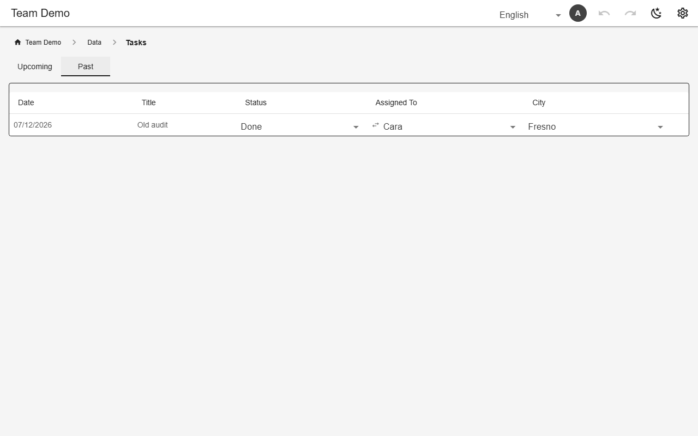

# Archive, auto-archive & copy forward

An `archivable` table gets **Upcoming / Past** tabs and an archive button per row; restore brings a row back. `archiveAfter` files rows away on their own — by a date passing, or a status left alone for a while. `copy` on a page copies a date range of rows (e.g. a week of classes) to a new date.



*The Past tab of an archivable table (demo)*

## Schema

Archive when a class is over:

```json
{"classes": {"archivable": true, "archiveAfter": {"dateColumn": "starts_at", "after": "2h"}}}
```

Archive approved chores after a week:

```json
{
  "chore_log": {
    "archivable": true,
    "archiveAfter": {"column": "status", "values": ["approved", "rejected"], "after": "7d"}
  }
}
```

- The status form needs a declared `updated_at` column (the clock).

## Backends

| In this browser | Supabase | Firebase | Dev server |
|---|---|---|---|
| ✅ | ✅ | ✅ | ✅ |

## Reference

- [SCHEMA.md → archiveAfter](../../SCHEMA.md#archiveafter-file-finished-rows-away-on-their-own)
- [SCHEMA.md → copy](../../SCHEMA.md#copy-copy-a-range-of-dated-rows-forward)

[← All features](../README.md)
