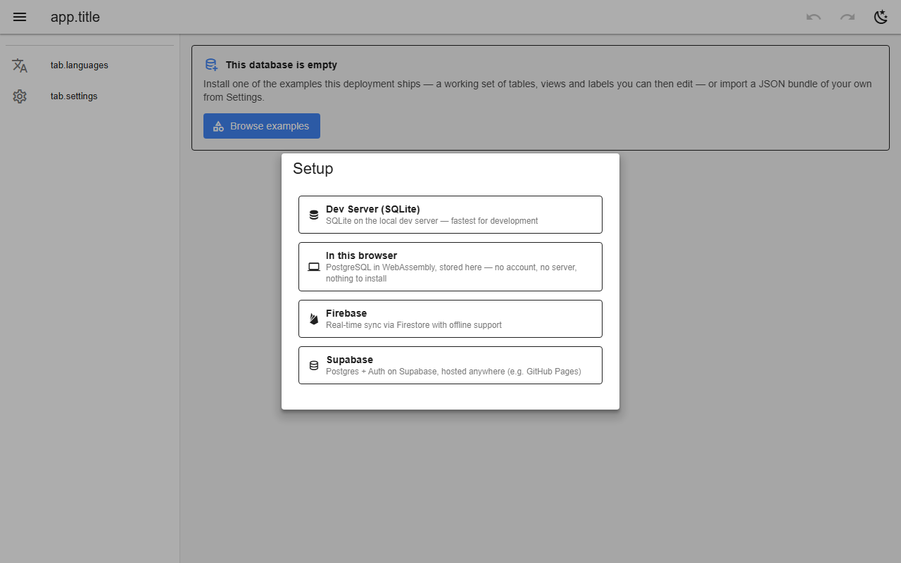

# Backends & setup

The setup screen picks where the data lives. **In this browser** runs PostgreSQL in WebAssembly in IndexedDB with the production access policies and no account. **Supabase** and **Firebase** are hosted and multi-user. The **dev server** runs the same Postgres policies locally. All implement one contract ([BACKEND_API.md](../../BACKEND_API.md)), checked by a conformance test.

*The setup screen*

## Backends

| In this browser | Supabase | Firebase | Dev server |
|---|---|---|---|
| ✅ | ✅ | ✅ | ✅ |

## Offline use

Keep working without a connection.

| In this browser | Supabase | Firebase | Dev server |
|---|---|---|---|
| ✅ | ❌ no offline cache | ✅ | — |

## Sign-in

| | In this browser | Supabase | Firebase | Dev server |
|---|---|---|---|---|
| Sign-in | none (self-asserted email) | Supabase Auth | Firebase Auth | trusted `X-User` header, loopback only |

## Reference

- [README → Backends](../../README.md#backends)
- [FIREBASE.md](../../FIREBASE.md)
- [SUPABASE.md](../../SUPABASE.md)

[← All features](../README.md)
