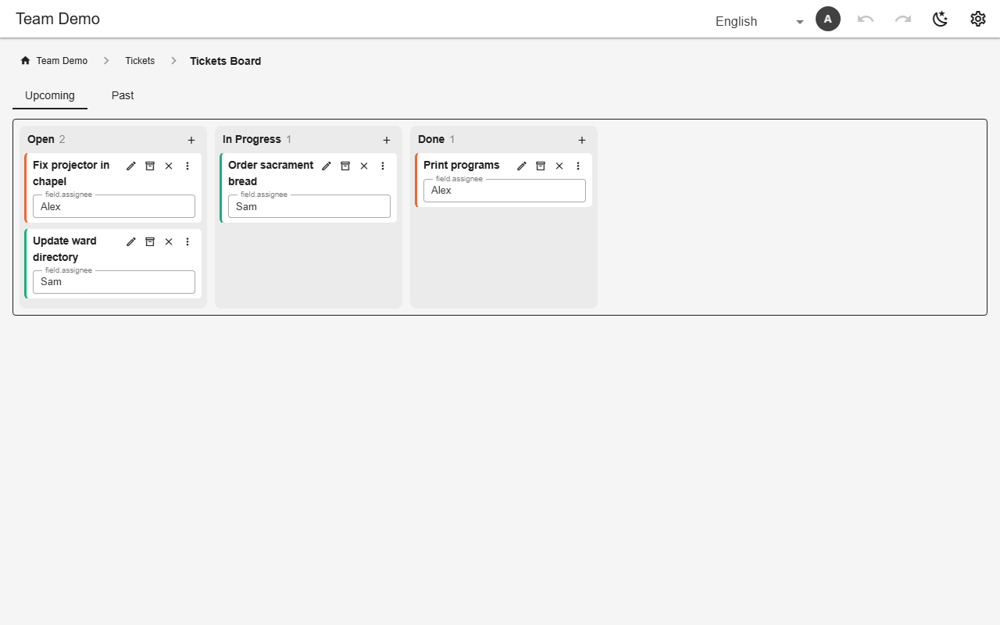

# Board (kanban)

A `board` view groups rows into lanes by a `select` column. Dragging a card writes the new value; `addInLane` adds a card straight into a lane, `color` tints cards by a column.



*Ticket board (`tickets_board`, demo)*

## Schema

Ticket board:

```json
{
  "name": "tickets_board",
  "kind": "board",
  "sources": ["tickets"],
  "mode": "join",
  "defaultSort": "title",
  "icon": "mdi-view-column-outline",
  "board": {
    "lane": "status",
    "lanes": ["open", "in_progress", "done"],
    "color": "assignee",
    "addInLane": true
  },
  "columns": ["title", "assignee"]
}
```

- `lanes` fixes the lane order; values not listed are not shown.
- `summary` makes cards compact: a closed card shows its title and these columns on one line; the chevron opens it with every field editable, and archive and delete beneath. Lanes fold by their heading.
- On a `reorderable` table, cards are ordered by hand: drop a card on another, or use its up/down arrows.

## Backends

| In this browser | Supabase | Firebase | Dev server |
|---|---|---|---|
| ✅ | ✅ | ✅ | ✅ |

## Reference

- [SCHEMA.md → board](../../SCHEMA.md#board-seventh-view-kind)

[← All features](../README.md)
