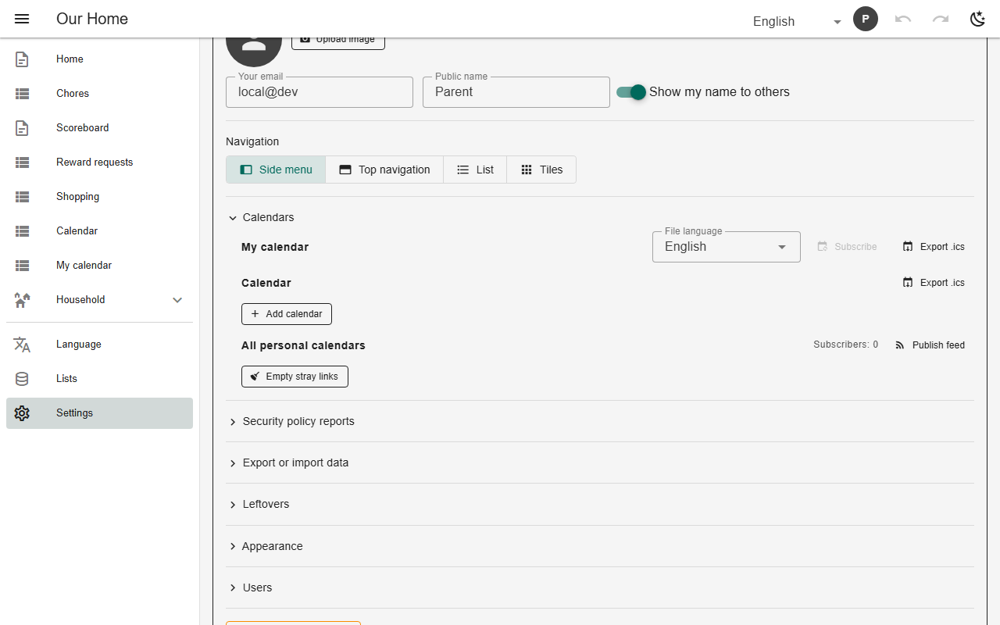

# Calendar feeds (subscribe)

`feed: true` publishes the calendar as an `.ics` file at a stable URL that phone and desktop calendars subscribe to. The app renders the file under a full-access identity and republishes it on every write. `feed: "per-person"` gives each member a private link holding only what is theirs. Settings → Calendars lists the feeds and sweeps stray files.



*Settings → Calendars: export, publish, per-person feeds (chores)*

## Schema

Shared and per-person feeds:

```json
{"name": "my_calendar", "kind": "calendar", "calendar": {"sources": ["…"], "feed": "per-person"}}
```

- The file lives in the backend's file storage (`uploadFile`); without storage the publish button does not appear.

## Backends

| In this browser | Supabase | Firebase | Dev server |
|---|---|---|---|
| ❌ no file storage | ✅ | ⚠️ needs Storage (Blaze plan) | ✅ |

## Reference

- [SCHEMA.md → publishing a feed](../../SCHEMA.md#publishing-a-calendar-as-a-subscribable-feed-feed)
- [SCHEMA.md → per-person feeds](../../SCHEMA.md#per-person-feeds-feed-per-person)

[← All features](../README.md)
