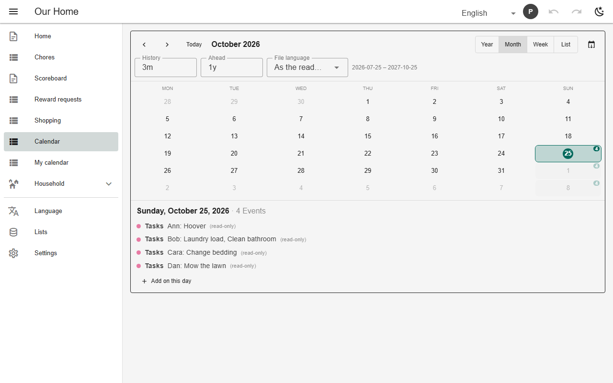
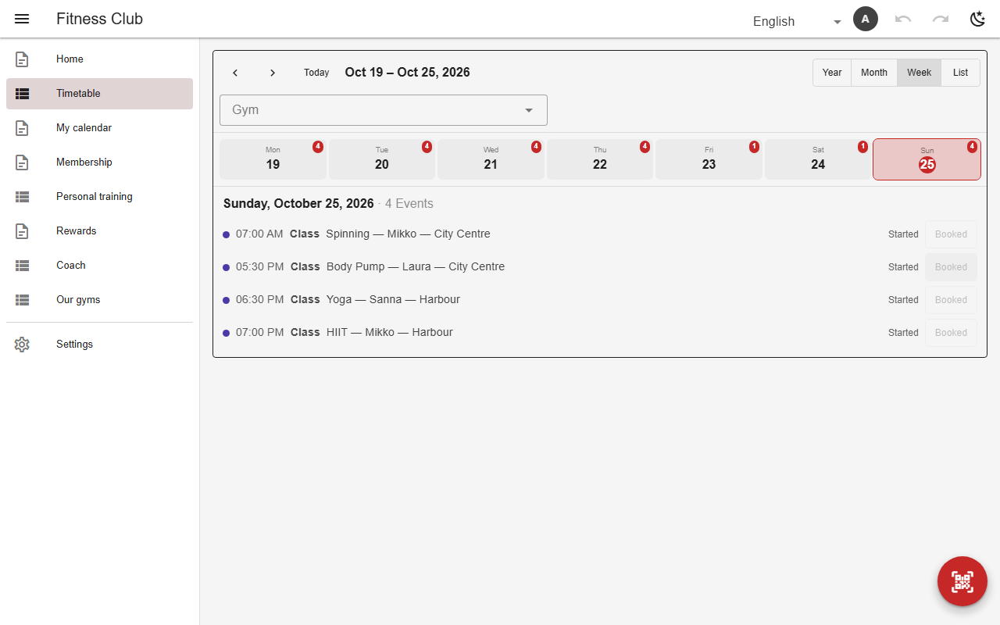

# Calendar

A `calendar` view places rows on their date. Several sources merge into one calendar, each labelled; `rotationSources` overlays a rotating roster. `addTo` lets the reader add a row on a clicked day, `respond` books an event from the calendar. **Export .ics** downloads the visible window; admins can also add calendars in Settings → Calendars without editing the schema.



*Month view with chores, shopping and duty rota (`home_calendar`, chores)*



*Class calendar (`class_calendar`, gym)*

## Schema

Multi-source calendar:

```json
{
  "name": "home_calendar",
  "calendar": {
    "sources": [
      {
        "table": "chore_log",
        "dateColumn": "done_on",
        "titleColumns": ["chore", "person"],
        "label": "Chore"
      },
      {
        "table": "home_shopping",
        "dateColumn": "needed_by",
        "titleColumns": ["item"],
        "label": "Shopping"
      }
    ],
    "rotationSources": [{"view": "duty_matrix", "label": "Tasks"}],
    "defaultView": "month",
    "weekStart": 1,
    "addTo": "chore_log"
  },
  "icon": "mdi-calendar-check",
  "kind": "calendar"
}
```

- `defaultView`: `year` | `month` | `week` | `list`; `weekStart`.
- `filters` lets the reader narrow by a column (pick-filters).
- A `datetime` source becomes a timed event; `durationColumn` sets its end.

## Backends

| In this browser | Supabase | Firebase | Dev server |
|---|---|---|---|
| ✅ | ✅ | ✅ | ✅ |

## Reference

- [SCHEMA.md → calendar](../../SCHEMA.md#calendar-fourth-view-kind)
- [SCHEMA.md → calendars built in the app](../../SCHEMA.md#calendars-built-in-the-app-not-the-schema)

[← All features](../README.md)
