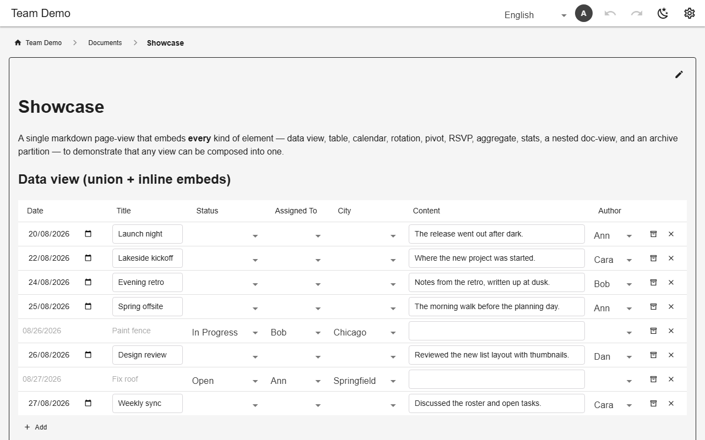

# Tables & column types

Each table lists its columns. `select` draws from a named list (`multiple: true` for several values), `ref` points at a lookup table, `owner` stamps the creating user. Column properties add defaults, hiding, sorting, read-only and `defaultFrom: "@me"`. Tables are created on first write.



*Typed cells editing in place*

## Schema

A table:

```json
{
  "chore_log": {
    "archivable": true,
    "defaultSort": "done_on",
    "columns": [
      {"name": "owner", "type": "owner"},
      {"name": "person", "type": "select", "list": "members", "sorted": true, "defaultFrom": "@me"},
      {"name": "chore", "type": "ref", "table": "ref_chores", "valueCol": "chore"},
      {"name": "done_on", "type": "date"},
      {
        "name": "status",
        "type": "select",
        "list": "chore_status",
        "picker": "toggle",
        "default": "logged"
      },
      {"name": "note", "type": "text"},
      {"name": "created_at", "type": "text", "hidden": true},
      {"name": "updated_at", "type": "text", "hidden": true}
    ],
    "archiveAfter": {"column": "status", "values": ["approved", "rejected"], "after": "7d"},
    "ownerWritable": ["person", "chore", "done_on", "note"],
    "ownerWritableWhile": {"status": "logged"}
  }
}
```

- Types: `text`, `number`, `date`, `datetime`, `select`, `ref`, `url`, `image`, `owner`.
- `reorderable` adds up/down buttons over a `position` column.
- Point your editor at `schema.schema.json` for completion and checking.

## Backends

| In this browser | Supabase | Firebase | Dev server |
|---|---|---|---|
| ✅ | ✅ | ✅ | ✅ |

## Reference

- [SCHEMA.md → tables](../../SCHEMA.md#tables)
- [SCHEMA.md → column types](../../SCHEMA.md#column-types)
- [SCHEMA.md → column properties](../../SCHEMA.md#column-properties)

[← All features](../README.md)
