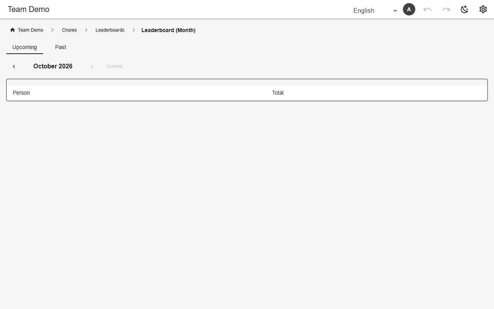

# Computed & conditional columns

A column with `computed` is never stored. On a table it is visible to every reader; in a view it is the view's own. `when` shows a column (or embed) only for rows that match a condition.



*Points looked up per row, then summed*

## Schema

Lookup, count and date arithmetic:

```json
[
  {
    "name": "points",
    "computed": {"lookup": {"table": "chores", "match": "chore", "on": "chore", "field": "points"}}
  },
  {
    "name": "pauses_used",
    "computed": {"count": "pauses", "on": "membership", "where": {"sent": "yes"}}
  },
  {
    "name": "valid_until",
    "computed": {
      "dateAdd": {
        "from": "start_on",
        "months": {"col": "plan.months"},
        "weeks": {"col": "pauses_used"},
        "days": -1
      }
    }
  },
  {"name": "content", "when": {"status": "in_progress"}}
]
```

- Operators: `lookup`, `count`, `add`, `dateAdd`, `streakAt`, rotation, and condition operators in `when`.

## Backends

| In this browser | Supabase | Firebase | Dev server |
|---|---|---|---|
| ✅ | ✅ | ✅ | ✅ |

## Reference

- [SCHEMA.md → computed columns](../../SCHEMA.md#computed-columns)
- [SCHEMA.md → conditional columns](../../SCHEMA.md#conditional-computed-columns-when-condition-operators)

[← All features](../README.md)
