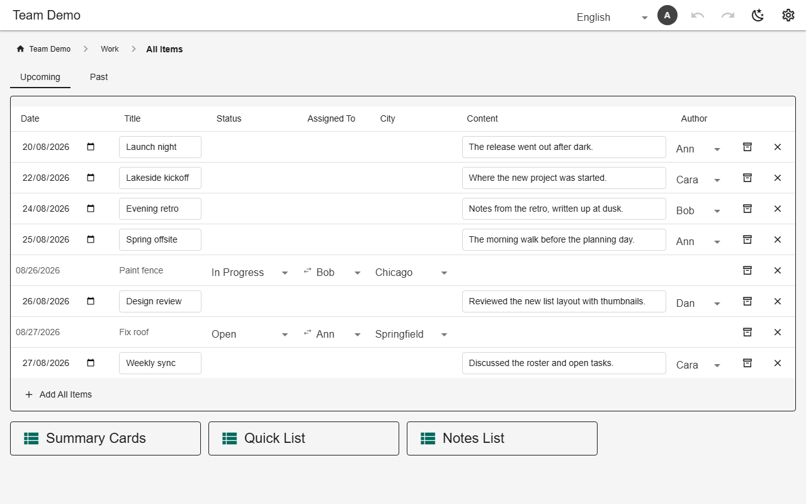
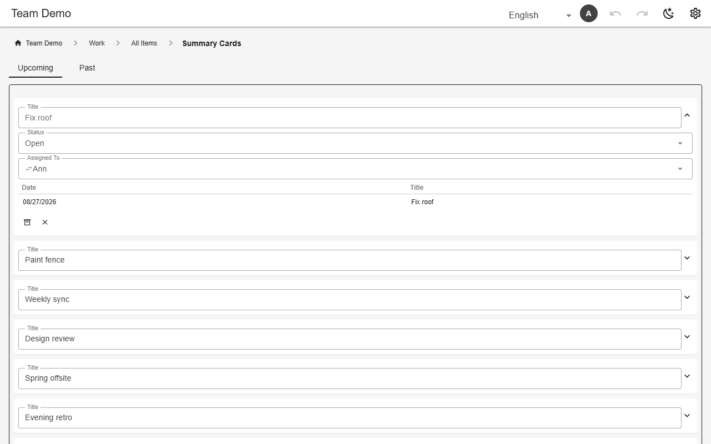
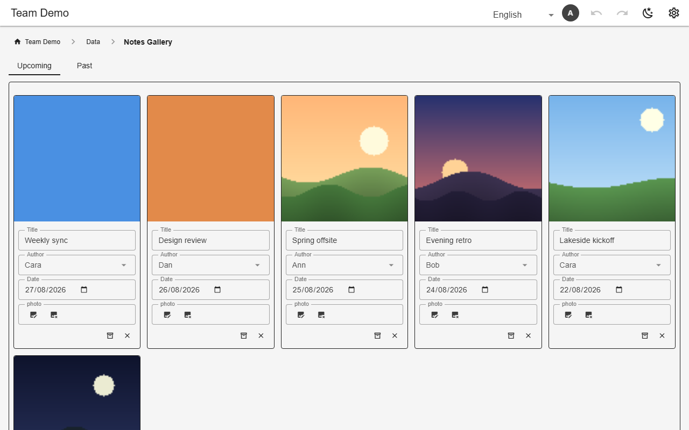
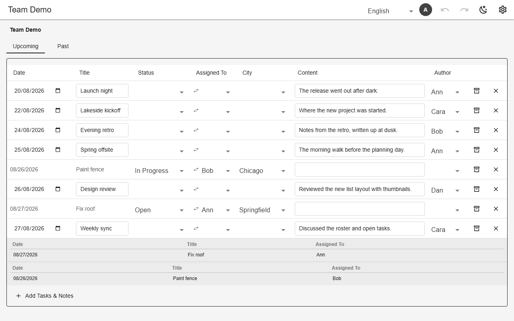

# Data views (table, cards, gallery)

A view lists rows from its `sources`. `mode: "union"` stacks the rows of several tables; `mode: "join"` lines up one table with columns from others. `layout` picks a table, cards or a gallery, and the app switches to cards on a narrow screen. Cells edit in place and save on change. A column may embed another view, filtered per row (`filterBy`), for master–detail.



*Union of tasks and notes (`all_items`, demo)*



*Card layout with a per-card embedded view (`summary_cards`)*



*Gallery layout over an image column (`notes_gallery`)*



*Join with inline filtered sub-tables (`combined`)*

## Schema

Union, table layout:

```json
{
  "name": "all_items",
  "kind": "data",
  "sources": ["tasks", "notes"],
  "hideEmpty": true,
  "columns": [
    "date",
    "title",
    "status",
    "assigned_to",
    {"name": "city", "hideEmpty": false},
    {"name": "content", "when": {"status": "in_progress"}},
    "author"
  ],
  "mode": "union",
  "defaultSort": "date",
  "layout": "table"
}
```

Cards with an embedded view per card:

```json
{
  "name": "summary_cards",
  "kind": "data",
  "sources": ["tasks", "notes"],
  "mode": "union",
  "layout": "card",
  "collapsed": true,
  "columns": [
    "title",
    "status",
    "assigned_to",
    {
      "view": "open_tasks",
      "filterBy": {"assigned_to": "assigned_to"},
      "hideEmpty": true,
      "bare": true
    }
  ]
}
```

Gallery:

```json
{
  "name": "notes_gallery",
  "kind": "data",
  "sources": ["notes"],
  "mode": "union",
  "layout": "gallery",
  "columns": ["photo", "title", "author", "date"]
}
```

- `filter` narrows rows (equality, `$or`/`$and`, `matchList`, `within: "@month"`, `@me`).
- `defaultSort`, `hideEmpty`, `readonly`, `collapsed`, `period` (‹ › stepping through months/weeks).
- A column `{ "view": …, "filterBy": {…} }` embeds a view per row.

## Backends

| In this browser | Supabase | Firebase | Dev server |
|---|---|---|---|
| ✅ | ✅ | ✅ | ✅ |

## Reference

- [SCHEMA.md → views (flat)](../../SCHEMA.md#views-flat)
- [SCHEMA.md → filters](../../SCHEMA.md#filters)
- [SCHEMA.md → filterBy](../../SCHEMA.md#filterby-per-card-master-detail)

[← All features](../README.md)
