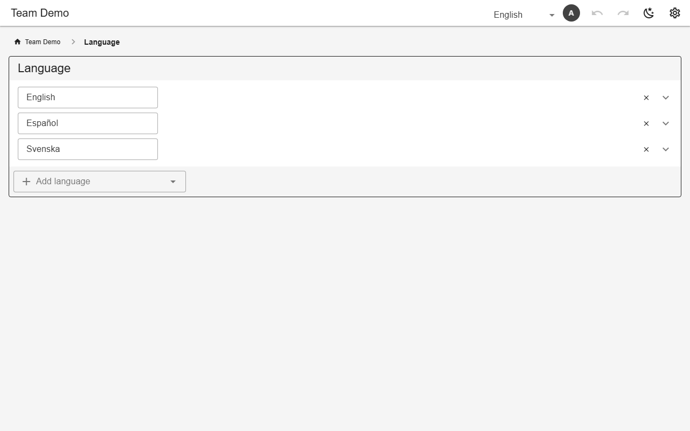

# Languages & translations

Keys are generated from the schema (`tab.*`, `view.*`, `field.*`, `list.*.*`, `nav.*`) and from `{{t:key}}` in pages. The **Language** tab adds languages and edits every key; each user picks their language in the app bar. Calendars and dates follow the chosen language.



*The Language tab (demo)*

## Schema

Default language:

```json
{"defaultLanguage": "en"}
```

- A list value is a key; its label is `list.<list>.<value>`.

## Backends

| In this browser | Supabase | Firebase | Dev server |
|---|---|---|---|
| ✅ | ✅ | ✅ | ✅ |

## Reference

- [SCHEMA.md → lists and translations](../../SCHEMA.md#lists-and-translations)

[← All features](../README.md)
