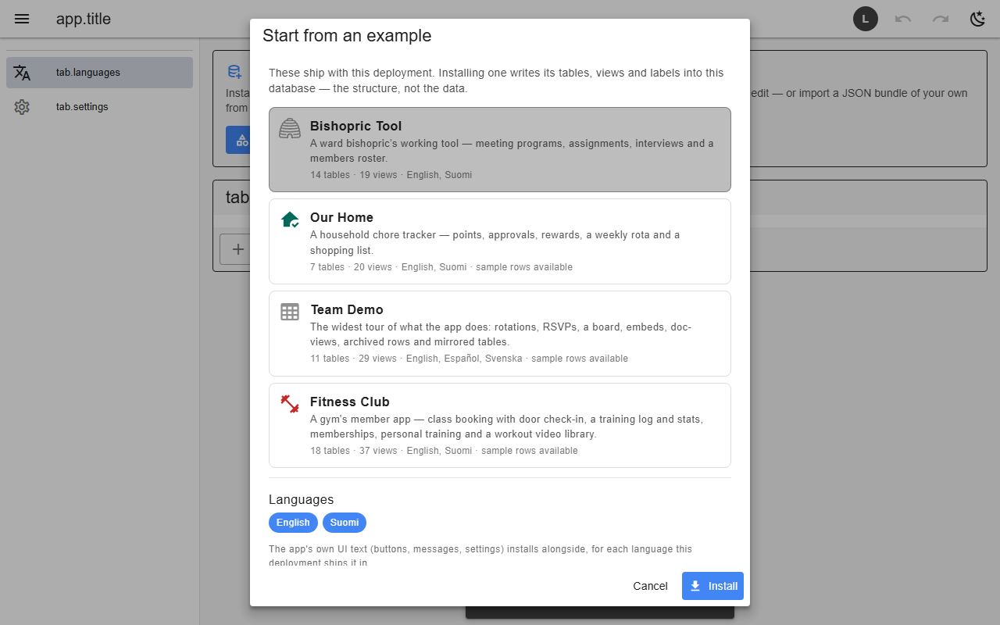

# Import, export & examples

Settings → Export writes schema, rows, lists and translations to one JSON file; Import reads it back (also into another backend, e.g. from the browser to Supabase). An empty database offers the shipped examples; installing one writes its tables, views, labels and optional sample rows. Users and grants are never part of a bundle.

*The example picker on an empty database*

- A database that installed an example is told when the deployment ships a newer revision.

## Backends

| In this browser | Supabase | Firebase | Dev server |
|---|---|---|---|
| ✅ | ✅ | ✅ | ✅ |

## Reference

- [examples/README.md](../../examples/README.md)

[← All features](../README.md)
