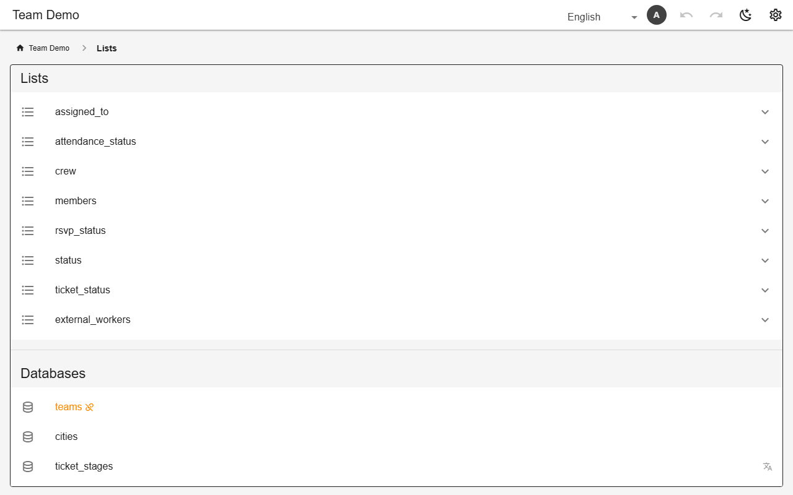

# Lists & lookup tables

List values are stored as stable keys and shown through translations. The **Lists** tab edits them and the lookup tables (`isLookup`), including hierarchical ones (`hierarchy`). Values a schema filter names are locked. `userWritableLists` lets members add values; `translatableLists` puts lookup rows into the Languages tab.



*The Lists tab: lists and lookup tables (demo)*

## Schema

Hierarchical lookup table:

```json
{
  "ref_duties": {
    "isLookup": true,
    "hierarchy": {"parent": "person", "value": "tasks"},
    "reorderable": true,
    "defaultSort": "position",
    "columns": [
      {"name": "position", "type": "number", "hidden": true},
      {"name": "person", "type": "select", "list": "members", "sorted": true},
      {"name": "tasks", "type": "select", "list": "ref_chores", "sorted": true, "multiple": true}
    ]
  }
}
```

Translatable lists:

```json
{"translatableLists": ["booking_status", "attendance_status", "order_state", "membership_status"]}
```

- A `list:` may name a lookup table instead of a list.
- Settings → Leftovers finds lists and tables nothing refers to any more.

## Backends

| In this browser | Supabase | Firebase | Dev server |
|---|---|---|---|
| ✅ | ✅ | ✅ | ✅ |

## Reference

- [SCHEMA.md → translatable lists](../../SCHEMA.md#translatable-lists-translatablelists)
- [SCHEMA.md → who may edit a list](../../SCHEMA.md#who-may-edit-a-list-userwritablelists)
- [SCHEMA.md → hierarchy](../../SCHEMA.md#hierarchy-which-column-of-a-lookup-is-the-group)
- [SCHEMA.md → lists and translations](../../SCHEMA.md#lists-and-translations)

[← All features](../README.md)
