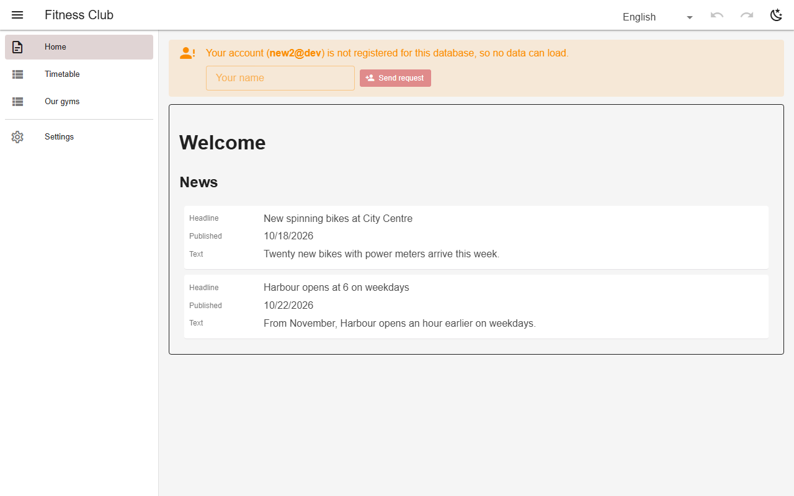
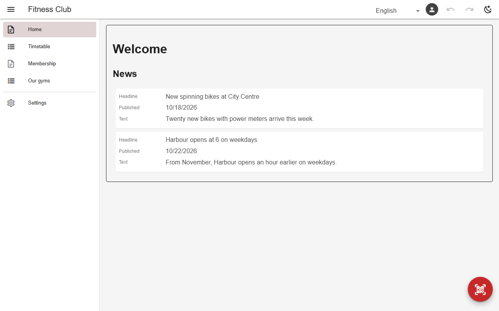

# Membership requests & open sign-up

An unregistered account sees a request form; the admin approves or denies it in Settings → Users, and approval applies the schema's `newUser` grant. With `newUser.open: true` nobody approves: a new account registers itself with exactly that grant, which the backend checks field by field.



*Request form for an unregistered account (gym)*



*With open sign-up, a new account joins as a member straight away*

## Schema

New-member grant:

```json
{
  "newUser": {
    "role": "viewer",
    "tables": {
      "classes": "r",
      "news": "r",
      "coach_library": "r",
      "ref_gyms": "r",
      "ref_rooms": "r",
      "ref_class_types": "r",
      "ref_plans": "r",
      "ref_exercises": "r",
      "ref_rewards": "r"
    },
    "open": true
  }
}
```

- The role is `viewer` or `editor`, never `admin`.

## Backends

| In this browser | Supabase | Firebase | Dev server |
|---|---|---|---|
| ✅ | ✅ | ✅ | ✅ |

## Reference

- [SCHEMA.md → membership requests](../../SCHEMA.md#membership-requests-self-service-admin-approved)

[← All features](../README.md)
