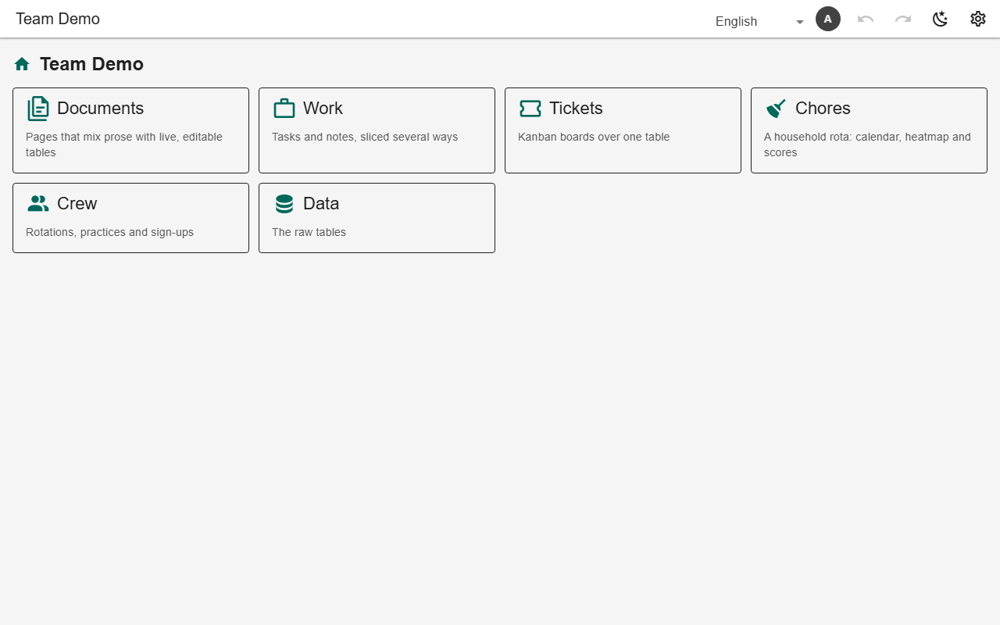
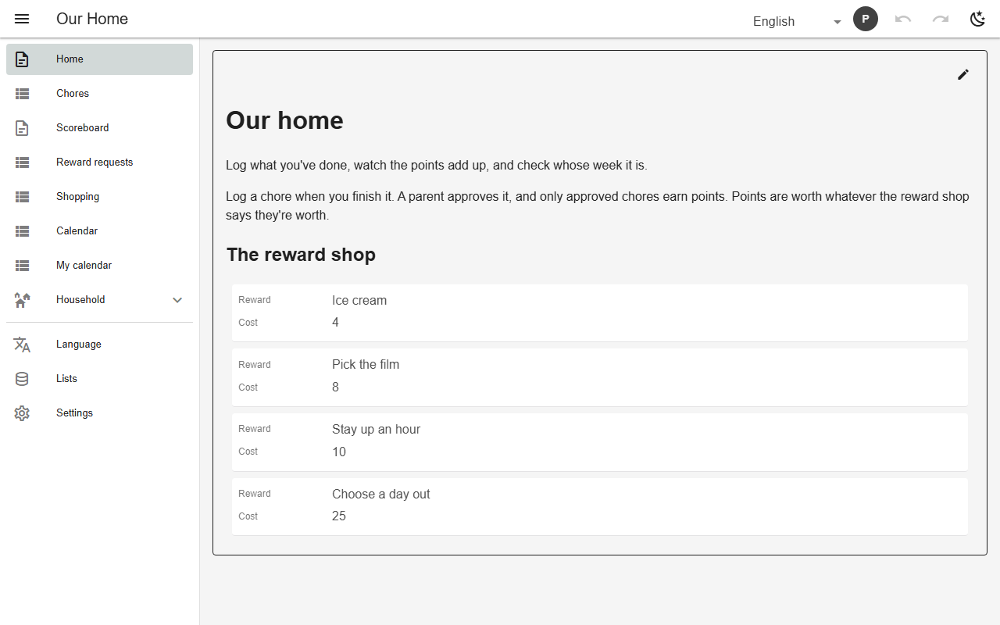

# Navigation

`nav` lists the screens in order, grouped to any depth. `layout` is a drawer, top tabs or browse pages (with `display: "tiles"`); each user may switch layout in Settings. `bottomNav` adds a phone bottom bar, `roles` / `requiresGrant` hide items, and every screen is a browser history entry.



*Browse layout as tiles (demo)*



*Drawer with a group (chores)*


*Phone layout with bottom navigation and scan button (gym)*

## Schema

Drawer, role-based group, bottom bar:

```json
{
  "layout": "drawer",
  "items": [
    {"view": "doc_home"},
    {"view": "class_calendar"},
    {"view": "doc_mycal", "roles": ["viewer"]},
    {"view": "doc_membership", "roles": ["viewer"]},
    {"view": "pt_mine", "roles": ["viewer"]},
    {"view": "doc_loyalty", "roles": ["viewer"]},
    {"view": "coach"},
    {"view": "gyms"},
    {
      "group": "Front desk",
      "icon": "mdi-desk",
      "items": [
        {"view": "class_booking"},
        {"view": "visit_scan"},
        {"view": "membership_desk"},
        {"view": "pt_board"},
        {"view": "reward_board"},
        {"view": "doc_stats"},
        {"view": "class_schedule"},
        {"table": "news"},
        {"table": "coach_library"}
      ],
      "roles": ["admin", "editor"],
      "requiresGrant": true
    }
  ],
  "bottomNav": ["doc_home", "class_calendar", "doc_mycal", "coach", "doc_loyalty"],
  "scan": ["visit_scan", "class_booking"]
}
```

- `fab: "scan"` and `nav.scan` add a floating scan button.

## Backends

| In this browser | Supabase | Firebase | Dev server |
|---|---|---|---|
| ✅ | ✅ | ✅ | ✅ |

## Reference

- [SCHEMA.md → nav](../../SCHEMA.md#nav-structure-layout)

[← All features](../README.md)
