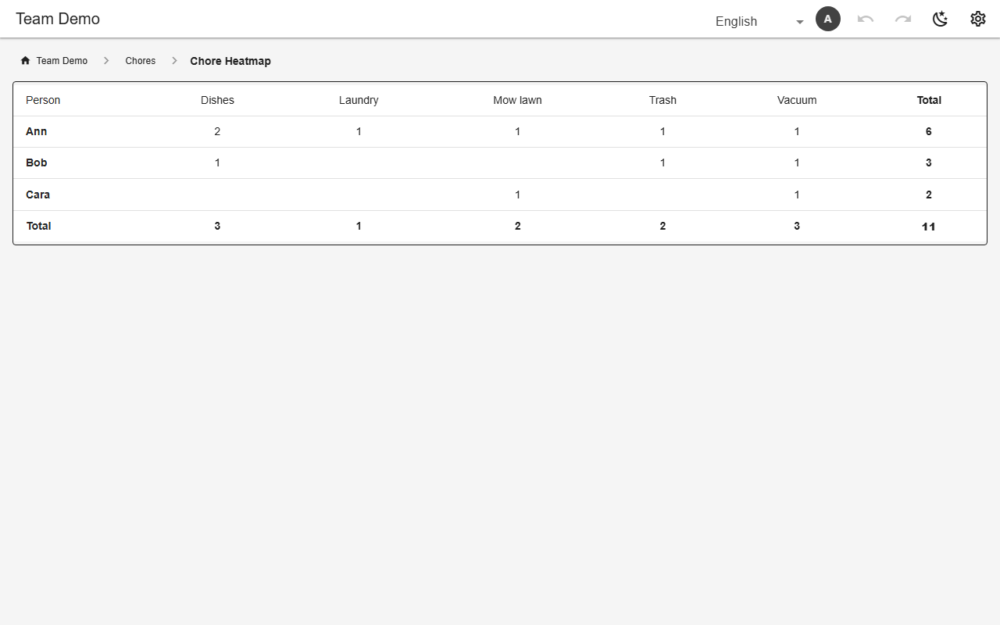

# Pivot (cross-tab)

A `pivot` view crosses one column (rows) with another (columns) and fills each cell with a count or sum. Read-only; its source can be a table or another view.



*Chores per person (`chore_heatmap`, demo)*

## Schema

Chores per person:

```json
{
  "name": "chore_heatmap",
  "kind": "pivot",
  "pivot": {
    "source": "chore_log",
    "row": "person",
    "column": "chore",
    "aggregate": "count",
    "totals": "count"
  }
}
```

- `aggregate`: `count` or `sum` of a number column; `totals` adds a total row and column.

## Backends

| In this browser | Supabase | Firebase | Dev server |
|---|---|---|---|
| ✅ | ✅ | ✅ | ✅ |

## Reference

- [SCHEMA.md → pivot](../../SCHEMA.md#pivot-fifth-view-kind)

[← All features](../README.md)
