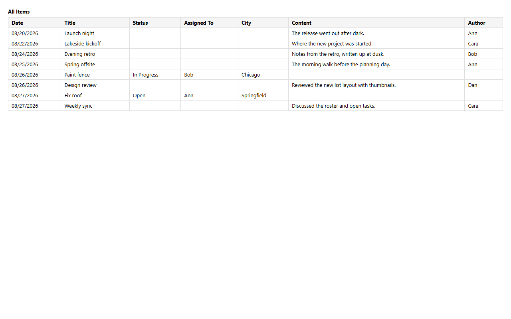

# Print

`printable` adds a print button to a view (`"view"`), to each card (`"cards"`), or both. The print layout follows the view's layout and includes its embeds; a `@both` embed prints both partitions.



*Print layout of a union view (demo)*

## Schema

Printable view:

```json
{"name": "all_items", "printable": ["view", "cards"], "…": "…"}
```

- Scan views print a sheet of code labels.

## Backends

| In this browser | Supabase | Firebase | Dev server |
|---|---|---|---|
| ✅ | ✅ | ✅ | ✅ |

## Reference

- [SCHEMA.md → view properties](../../SCHEMA.md#view-properties)

[← All features](../README.md)
