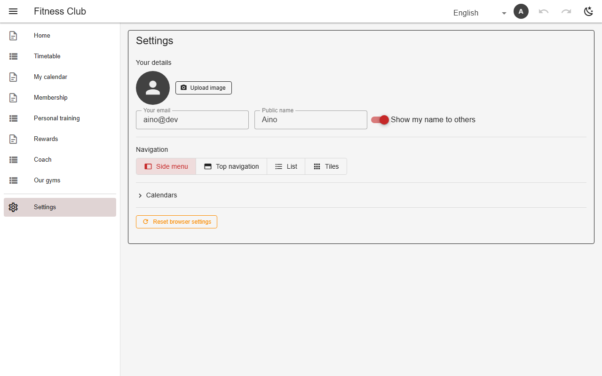

# Profiles & user-linked lists

Each user sets a public name and picture in Settings and chooses whether to share the name. `listSources` feeds a list from shared profiles (`users`) or links curated list values to accounts (`userlink`), so `@me` filters, `mineOnly` rotations and avatars resolve to the signed-in person.



*Settings → Your details (gym, as a member)*

## Schema

User-linked list:

```json
{"listSources": {"members": "userlink"}}
```

- `userlink-name`: the value names a role, the cell shows who holds it.

## Backends

| In this browser | Supabase | Firebase | Dev server |
|---|---|---|---|
| ✅ | ✅ | ✅ | ✅ |

## Reference

- [SCHEMA.md → profiles](../../SCHEMA.md#user-profiles-user-backed-lists-membership-firebase)
- [SCHEMA.md → userlink](../../SCHEMA.md#listsources-listname-userlink-curated-names-linked-accounts)

[← All features](../README.md)
