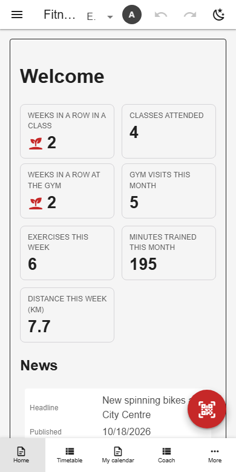

# Installable app & icons

The app is a PWA: a manifest and service worker let browsers install it into its own window. The manifest is rebuilt at runtime from the schema's title, `icons` and theme, so one deployment serving several databases installs each as its own app.



*Phone layout*

## Schema

Per-database icons:

```json
{
  "icons": {
    "favicon": "./examples/gym-favicon.svg",
    "appleTouch": "./examples/gym-icon-512.png",
    "png512": "./examples/gym-icon-512.png"
  }
}
```

- The install icon must be a square PNG of at least 144 px at a network URL.

## Backends

| In this browser | Supabase | Firebase | Dev server |
|---|---|---|---|
| ✅ | ✅ | ✅ | ✅ |

## Reference

- [SCHEMA.md → icons + title](../../SCHEMA.md#icons-title)
- [README → Installable (PWA)](../../README.md#installable-pwa)

[← All features](../README.md)
