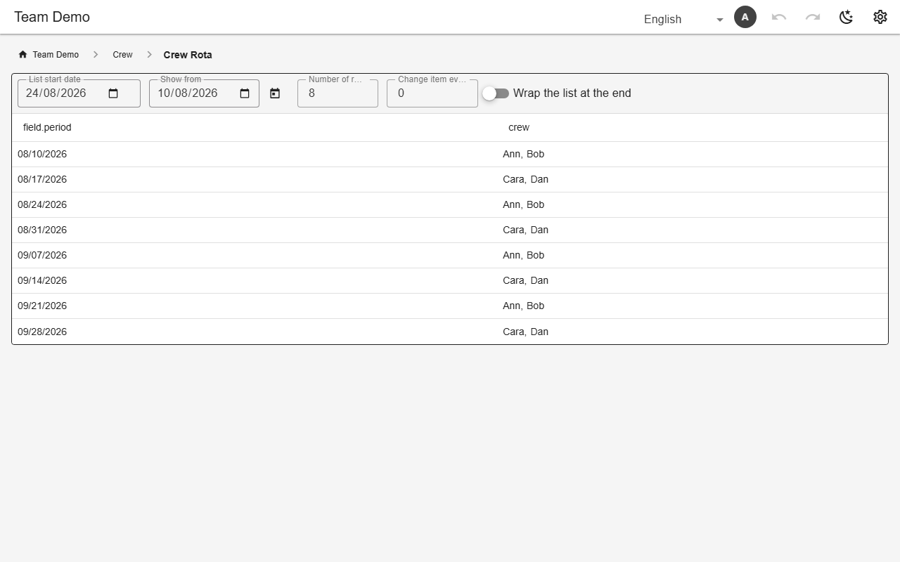
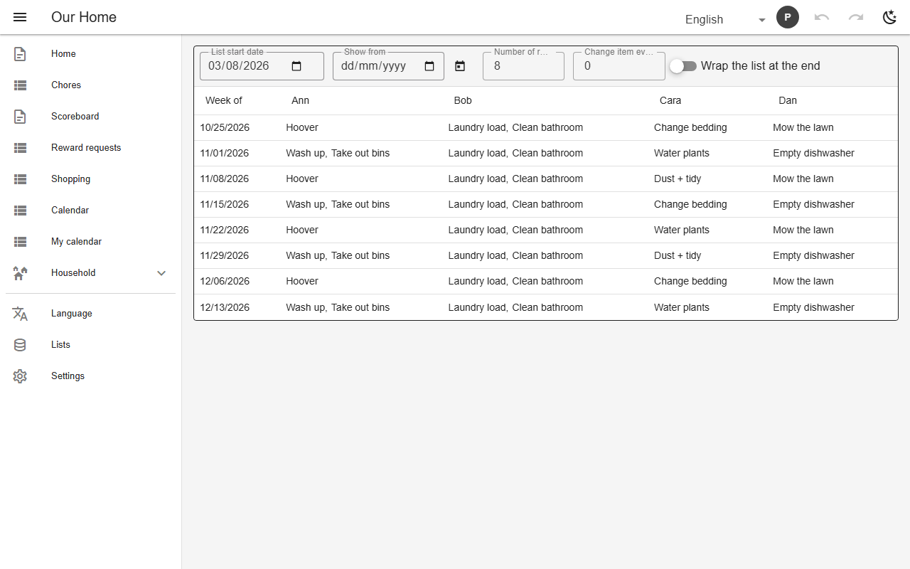

# Rotating rosters

A `rotation` view generates one row per period from ordered rosters — nothing is stored. Rosters may swap between slots (`slots` + `rosters` + `rotateEvery`), or come from one lookup table grouped by person (`rosterRef`). `mineOnly` shows each member only their own column. The anchor date and window are edited on the view itself. A rotation can also be a computed column in a data view, cycling per occurrence (e.g. ushers per meeting).



*Weekly crew rota (`crewrota`, demo)*



*Person × task matrix from one lookup table (`duty_matrix`, chores)*

## Schema

Weekly rota:

```json
{
  "name": "crewrota",
  "kind": "rotation",
  "rotation": {
    "columns": [
      {
        "name": "crew",
        "rotationTable": "crew_rotation",
        "advanceBy": "calendar",
        "interval": "weekly"
      }
    ],
    "range": {"from": "today", "periods": 12}
  },
  "layout": "table"
}
```

Person × task matrix:

```json
{
  "name": "duty_matrix",
  "layout": "table",
  "mineOnly": {"list": "members"},
  "rotation": {
    "rosterRef": "ref_duties",
    "rosterBy": "person",
    "valueCol": "tasks",
    "interval": "weekly",
    "range": {"from": "today", "periods": 8}
  },
  "icon": "mdi-table-account",
  "kind": "rotation"
}
```

- `interval`: `daily` | `weekly` | `monthly` | `yearly` | `<n><d|w|m|y>`.
- Occurrence rotations count archived rows too, so archiving a past occurrence keeps later turns in place.

## Backends

| In this browser | Supabase | Firebase | Dev server |
|---|---|---|---|
| ✅ | ✅ | ✅ | ✅ |

## Reference

- [SCHEMA.md → rotationView](../../SCHEMA.md#rotationview-third-view-kind)
- [SCHEMA.md → rotation columns](../../SCHEMA.md#rotation-columns-rotating-duty-rosters)
- [SCHEMA.md → rosterRef](../../SCHEMA.md#rosterref-one-2-d-lookup-instead-of-a-table-per-slot)

[← All features](../README.md)
