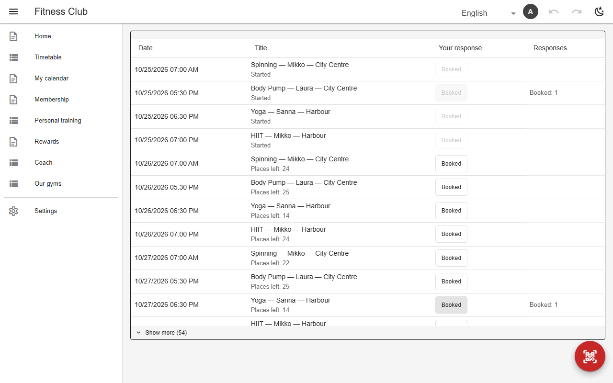

# RSVP & bookings

An `rsvp` view lists upcoming events from one table; each member records their own response in another, through an `owner` column — no write grant on the table needed. The response table's `capacity` caps places and refuses a booking when they run out. The view adds booking windows, membership requirements and self check-in with a shared code (a rotating QR on the organizer's screen).



*Class booking as a member (`class_booking`, gym)*

## Schema

Class booking:

```json
{
  "name": "class_booking",
  "kind": "rsvp",
  "icon": "mdi-calendar-check",
  "fab": "scan",
  "rsvp": {
    "events": "classes",
    "dateColumn": "starts_at",
    "ahead": "3d",
    "titleColumns": ["class_type", "instructor", "gym"],
    "responses": "bookings",
    "statusColumn": "booking",
    "picker": "toggle",
    "showCounts": true,
    "rosterVisibility": "admins",
    "checkin": {
      "codeColumn": "checkin_code",
      "set": {"attendance": "attended"},
      "rotateMinutes": 5,
      "link": "submit"
    },
    "closeBefore": "30min",
    "release": "10min",
    "blockedBy": {
      "table": "pauses",
      "from": "starts_on",
      "to": "pause_until",
      "where": {"sent": "yes"},
      "message": "text.paused"
    },
    "requires": {
      "table": "memberships",
      "from": "start_on",
      "to": "valid_until",
      "where": {"$or": [{"membership_status": "active"}, {"membership_status": "paused"}]},
      "message": "text.no_membership"
    }
  }
}
```

Responses with capacity:

```json
{
  "bookings": {
    "privateRoster": true,
    "ownerWritable": ["class", "booking", "checkin_code"],
    "ownerWritableWhile": {"attendance": "pending"},
    "capacity": {
      "link": "class",
      "status": "booking",
      "column": "capacity",
      "count": "booked",
      "holds": ["booked"],
      "reserved": "walk_ins",
      "waitlist": {"status": "waitlisted", "start": "starts_at", "until": "10min"}
    }
  }
}
```

- `ahead` / Show more, `closeBefore`, `release` (a no-show's place returns before the start).
- `blockedBy` / `requires`: refuse during a pause, allow only within a valid membership.
- `checkin`: a code typed or scanned marks attendance; `rotateMinutes` makes it a live QR.
- `capacity.waitlist` (above) queues members for a full event; see the waitlist below.

## Backends

| In this browser | Supabase | Firebase | Dev server |
|---|---|---|---|
| ✅ | ✅ | ✅ | ✅ |

## RSVP waitlist

A full event takes a queue; a cancellation books the longest-waiting member automatically.

| In this browser | Supabase | Firebase | Dev server |
|---|---|---|---|
| ✅ | ✅ | ❌ rules cannot promote; not offered | ✅ |

## Reference

- [SCHEMA.md → rsvp](../../SCHEMA.md#rsvp-sixth-view-kind)
- [SCHEMA.md → capacity](../../SCHEMA.md#capacity-places-and-the-booking-refused-when-they-are-gone)
- [SCHEMA.md → checkin](../../SCHEMA.md#checkin-self-check-in-with-a-shared-code)

[← All features](../README.md)
