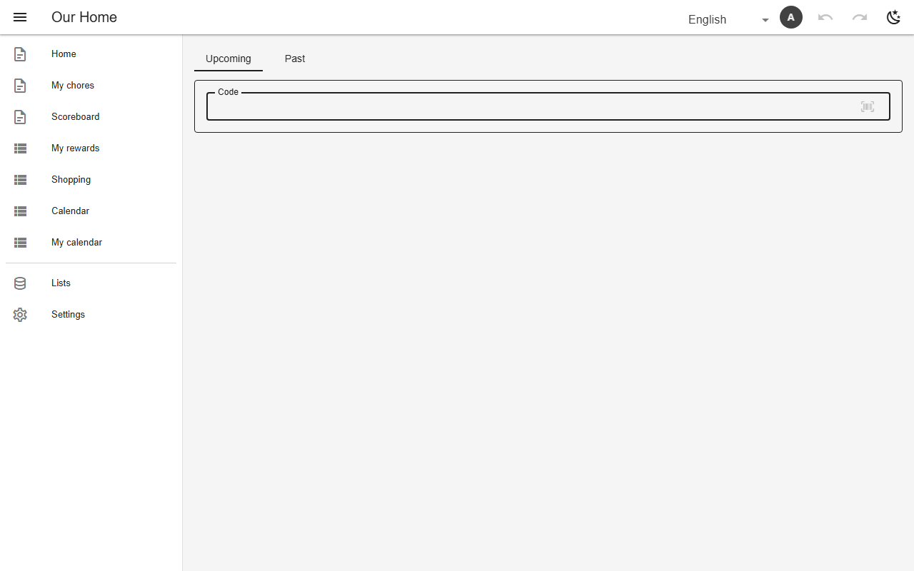

# Scan (barcode / QR)

A `scan` view turns a code into a new row: the code names a catalogue row, `set` fills in the rest (`@today`, `@now`). A handheld scanner works as a keyboard; a phone camera opens a `?view=…&scan=…` link; the app prints a sheet of Code 39 / QR labels. `verify` uses a rotating code shown on a screen at the door, so a photo of a printed code cannot log visits from home.



*Logging a chore by code (`chore_scan`, chores)*

## Schema

Chore by code:

```json
{
  "name": "chore_scan",
  "sources": ["chore_log"],
  "mode": "union",
  "kind": "scan",
  "icon": "mdi-barcode-scan",
  "defaultSort": "done_on",
  "filter": {"person": "@me"},
  "columns": ["done_on", "chore", "status"],
  "scan": {"column": "chore", "set": {"done_on": "@today"}, "link": "submit"}
}
```

Gym visit with a rotating door code:

```json
{
  "name": "visit_scan",
  "kind": "scan",
  "icon": "mdi-qrcode-scan",
  "sources": ["visits"],
  "mode": "union",
  "defaultSort": "visited_on",
  "filter": {"owner": "@me"},
  "columns": ["visited_on", "gym", "verified"],
  "scan": {
    "column": "gym",
    "codeCol": "code",
    "set": {"visited_on": "@today", "at": "@now"},
    "label": "text.door_code",
    "verify": {"claim": "door_code", "set": {"verified": "yes"}, "rotateMinutes": 5},
    "blockedBy": {
      "table": "pauses",
      "from": "starts_on",
      "to": "pause_until",
      "where": {"sent": "yes"},
      "message": "text.paused"
    },
    "requires": {
      "table": "memberships",
      "from": "start_on",
      "to": "valid_until",
      "where": {"$or": [{"membership_status": "active"}, {"membership_status": "paused"}]},
      "message": "text.no_membership"
    }
  }
}
```

- `once`: one scan per code; every outcome (created, unknown, duplicate, refused) is shown.
- `nav.scan` adds a floating scan button that routes a code to the right view.

## Backends

| In this browser | Supabase | Firebase | Dev server |
|---|---|---|---|
| ✅ | ✅ | ✅ | ✅ |

## Reference

- [SCHEMA.md → scan](../../SCHEMA.md#scan-eleventh-view-kind)
- [SCHEMA.md → verify](../../SCHEMA.md#a-code-that-changes-verify-a-screen-at-the-door-vouches-for-it)
- [SCHEMA.md → printing the codes](../../SCHEMA.md#printing-the-codes)

[← All features](../README.md)
