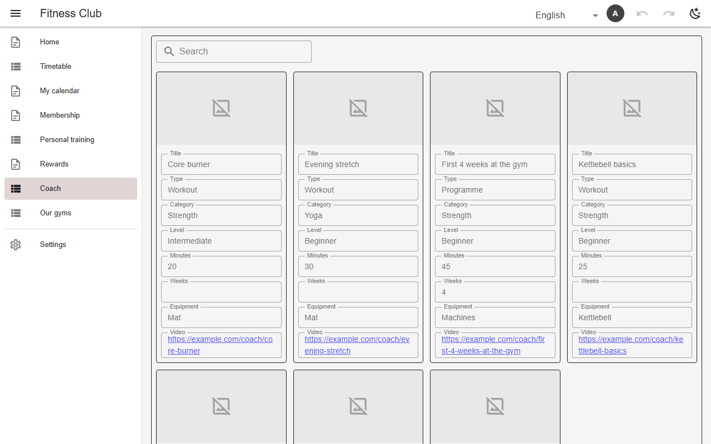
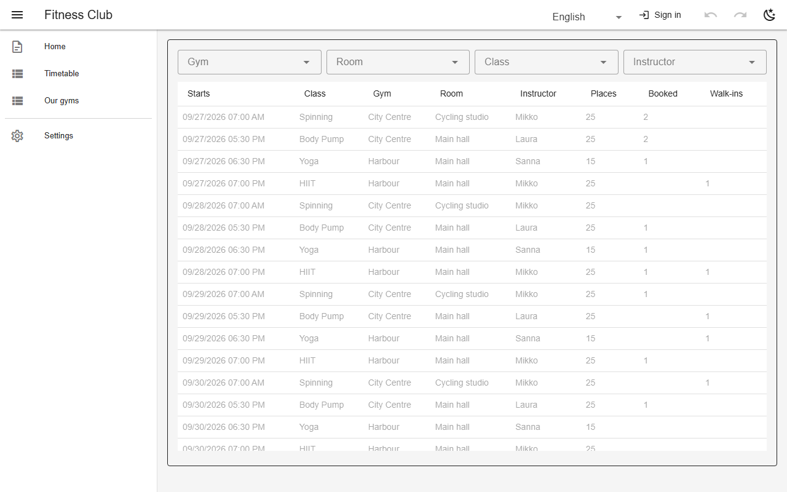

# Search & reader filters

`search` on a view puts a box above it that matches the listed columns. `filters` on a page or calendar adds multi-select drop-downs; every embed on the page narrows by them at once.



*Search over the coach library (`coach`, gym)*



*Page filters above an embedded timetable (`class_schedule`, gym)*

## Schema

Search:

```json
{"name": "coach", "search": ["title", "category", "equipment"], "…": "…"}
```

Page filters:

```json
{
  "name": "class_schedule",
  "kind": "page",
  "icon": "mdi-calendar-edit",
  "filters": ["gym", "room", "class_type", "instructor"],
  "markdown": "{{view:class_list@both}}\n"
}
```

- `search: true` searches every column but bookkeeping ones; a table may carry `search` too.

## Backends

| In this browser | Supabase | Firebase | Dev server |
|---|---|---|---|
| ✅ | ✅ | ✅ | ✅ |

## Reference

- [SCHEMA.md → search](../../SCHEMA.md#search-a-box-the-reader-types-in)
- [SCHEMA.md → a page's search](../../SCHEMA.md#a-pages-search)
- [SCHEMA.md → calendar filters](../../SCHEMA.md#filters-the-reader-picks-filters)

[← All features](../README.md)
