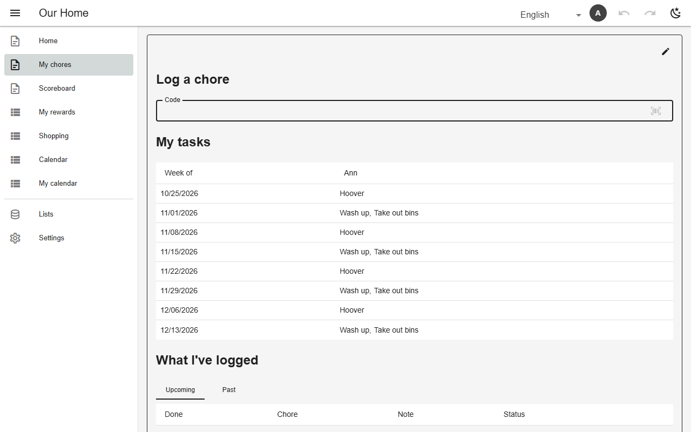

# Self-service rows (owner)

A table with an `owner` column stamps each new row with its creator. A member may read and write their own rows; `ownerWritable` names the columns they may set, `ownerWritableWhile` freezes a row once its status moves on (e.g. after approval or attendance is marked). Identity columns can only ever name the member themselves; `stamped` columns are set by the app and never rewritten.



*A member's own chores page (`doc_mine`, chores, as Ann)*

## Schema

Owner-written log:

```json
{
  "chore_log": {
    "ownerWritable": ["person", "chore", "done_on", "note"],
    "ownerWritableWhile": {"status": "logged"}
  }
}
```

- `privateRoster` hides other members' rows; `rosterPublic` publishes a row.
- Enforced in all four policy layers (Firestore rules, RLS, dev server).

## Backends

| In this browser | Supabase | Firebase | Dev server |
|---|---|---|---|
| ✅ | ✅ | ✅ | ✅ |

## Reference

- [SCHEMA.md → self-service tables](../../SCHEMA.md#self-service-tables-firebase)
- [SCHEMA.md → ownerWritable](../../SCHEMA.md#ownerwritable-which-columns-an-owner-may-set)
- [SCHEMA.md → verified attendance](../../SCHEMA.md#verified-attendance-a-status-the-member-cannot-set-which-then-freezes-their-entry)
- [SCHEMA.md → stamped](../../SCHEMA.md#stamped-a-column-the-app-fills-in-and-nobody-rewrites)

[← All features](../README.md)
