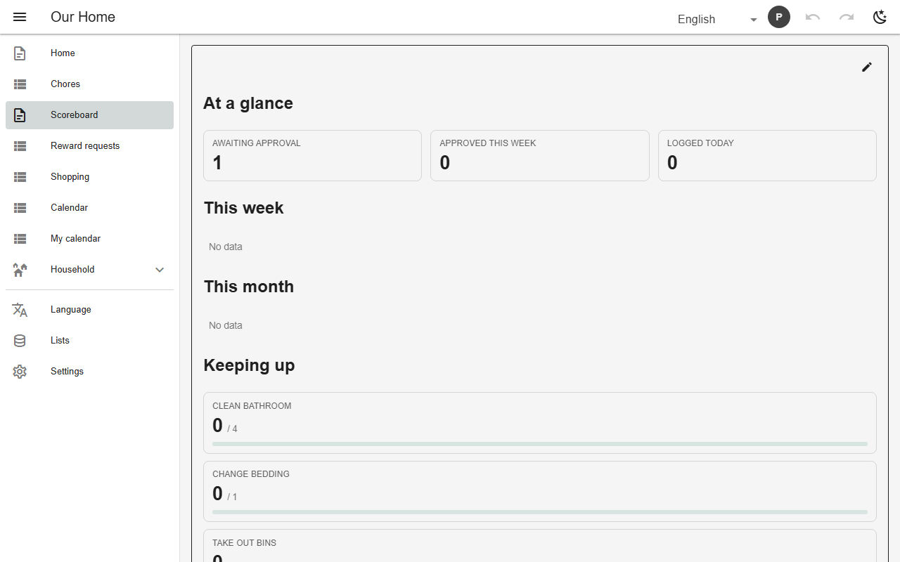
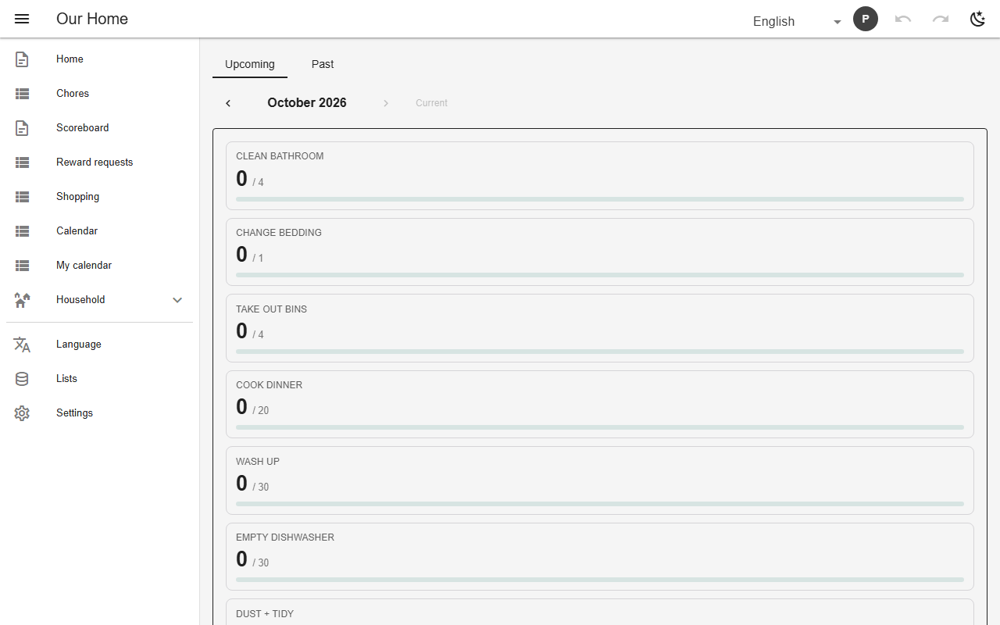
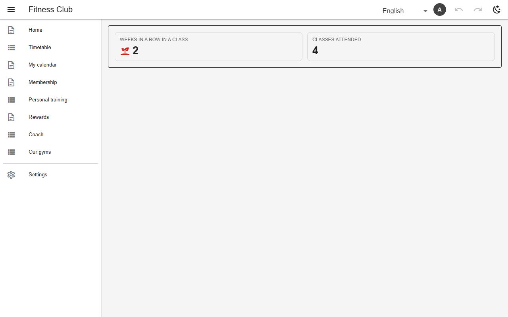
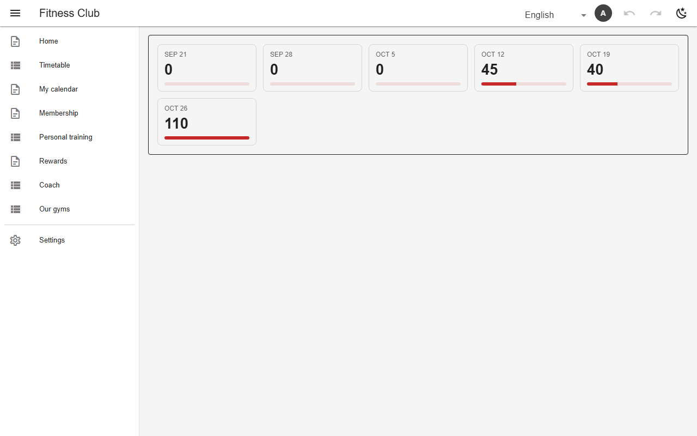

# Stats (KPI tiles)

A `stats` view shows numbers instead of rows: fixed `tiles` (count, sum, streak…) or one tile per aggregated row (`rowTiles`) with a goal from a column, so a leaderboard becomes progress bars. Streak tiles grow an icon with the number, and a `series` tile becomes one tile per week, month or day.



*At-a-glance tiles and progress against targets (chores scoreboard)*



*One tile per chore against its monthly target (`chore_cadence`)*



*Streak and count tiles for a member (`my_level`, gym)*



*Workout minutes for each of the last six weeks (`my_minutes_weeks`, gym)*

## Schema

Tiles with a streak:

```json
{
  "name": "my_level",
  "kind": "stats",
  "icon": "mdi-medal",
  "sources": ["bookings"],
  "mode": "union",
  "filter": {"$and": [{"owner": "@me"}, {"attendance": "attended"}]},
  "readonly": true,
  "includeArchive": true,
  "stats": {
    "display": "number",
    "tiles": [
      {
        "label": "text.streak_classes",
        "agg": "streak",
        "column": "class_start",
        "interval": "weekly",
        "icons": [
          {"at": 1, "icon": "mdi-sprout"},
          {"at": 3, "icon": "mdi-fire"},
          {"at": 8, "icon": "mdi-trophy"},
          {"at": 26, "icon": "mdi-crown"}
        ]
      },
      {"label": "text.classes_attended", "agg": "count"}
    ]
  },
  "compute": [
    {
      "name": "class_start",
      "source": "bookings",
      "computed": {"lookup": {"table": "classes", "match": "class", "on": "id", "field": "starts_at"}}
    }
  ]
}
```

A goal per row:

```json
{
  "name": "chore_cadence",
  "sources": ["chore_log"],
  "mode": "union",
  "groupBy": {"column": "chore", "from": ["chore"], "seed": true},
  "aggregate": {"count": true, "into": "done"},
  "columns": [
    "chore",
    "done",
    {
      "name": "target",
      "computed": {
        "lookup": {
          "table": "ref_chores",
          "match": "chore",
          "on": "chore",
          "field": "target_per_month",
          "default": 0
        }
      }
    }
  ],
  "period": "month",
  "filter": {"status": "approved", "done_on": {"within": "@month"}},
  "readonly": true,
  "icon": "mdi-calendar-check",
  "includeArchive": true,
  "kind": "stats",
  "stats": {
    "rowTiles": {
      "label": "chore",
      "value": "done",
      "goal": {"column": "target"},
      "order": "behind",
      "skipUntargeted": true
    }
  }
}
```

A tile per period:

```json
{"agg": "sum", "column": "minutes", "goal": "max", "series": {"column": "done_on", "interval": "weekly", "count": 6}}
```

- `order`: which end of a board is the point; tiered goals (bronze/silver/gold).

## Backends

| In this browser | Supabase | Firebase | Dev server |
|---|---|---|---|
| ✅ | ✅ | ✅ | ✅ |

## Reference

- [SCHEMA.md → stats](../../SCHEMA.md#stats-ninth-view-kind)
- [SCHEMA.md → a tile per period](../../SCHEMA.md#a-tile-per-period-series)
- [SCHEMA.md → tiered goals](../../SCHEMA.md#tiered-goals-bronze-silver-gold)

[← All features](../README.md)
