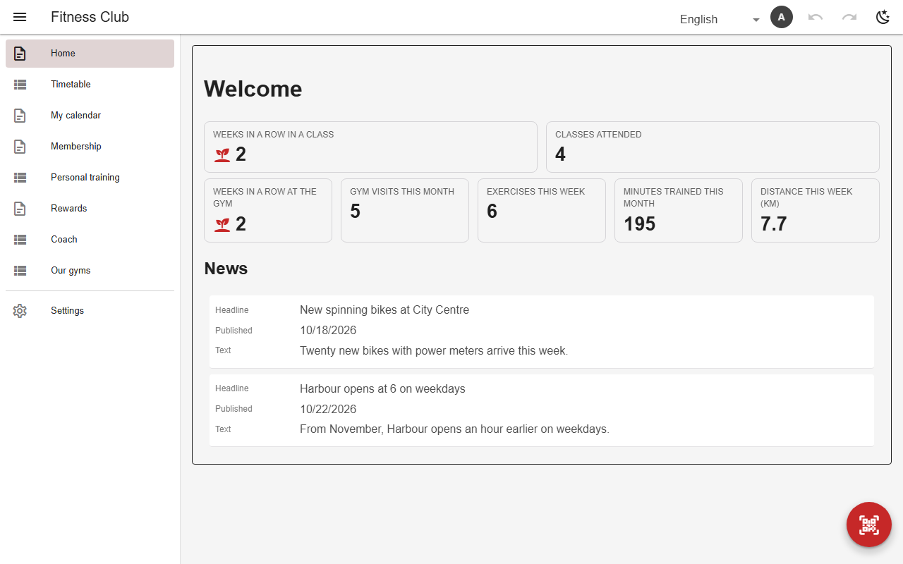
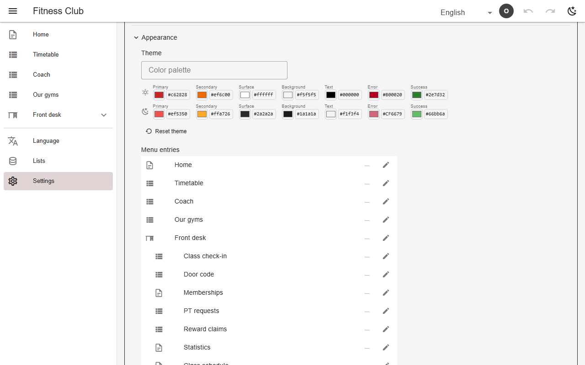

# Theme & appearance

`theme` sets the light and dark palette. Admins tweak it in Settings → Appearance (per-role pickers, or paste a palette) and it saves as they go. The same section sets a background image or menu picture for each nav entry. Every user can toggle dark mode.



*The gym's red palette*



*Settings → Appearance*

## Schema

Palette:

```json
{
  "theme": {
    "light": {"primary": "#c62828", "secondary": "#ef6c00", "success": "#2e7d32"},
    "dark": {"primary": "#ef5350", "secondary": "#ffa726", "success": "#66bb6a"}
  }
}
```

- The palette also drives the installed app's splash and title-bar colours.

## Backends

| In this browser | Supabase | Firebase | Dev server |
|---|---|---|---|
| ✅ | ✅ | ✅ | ✅ |

## Reference

- [SCHEMA.md → theme](../../SCHEMA.md#theme-brand-palette)
- [SCHEMA.md → background images](../../SCHEMA.md#background-images)

[← All features](../README.md)
