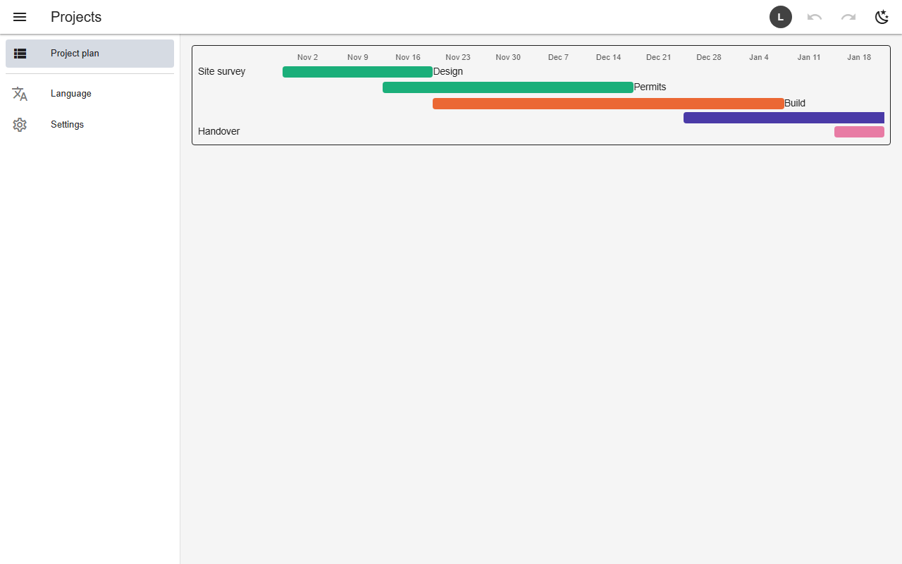

# Timeline (gantt)

A `timeline` view draws each row as a bar from `start` to `end` over a window of periods. A row with no end is one period long; rows outside the window are dropped, and bars crossing an edge are squared off.



*A project plan over 12 weeks*

## Schema

Project plan:

```json
{
  "name": "project_plan",
  "kind": "timeline",
  "sources": ["projects"],
  "mode": "union",
  "columns": ["title", "starts_on", "due_on"],
  "timeline": {"start": "starts_on", "end": "due_on", "label": ["title"], "periods": 12, "interval": "weekly"}
}
```

- `from` defaults to today; `interval` uses the rotation vocabulary (`weekly`, `2w`, `3m`…).

## Backends

| In this browser | Supabase | Firebase | Dev server |
|---|---|---|---|
| ✅ | ✅ | ✅ | ✅ |

## Reference

- [SCHEMA.md → timeline](../../SCHEMA.md#timeline-tenth-view-kind)

[← All features](../README.md)
