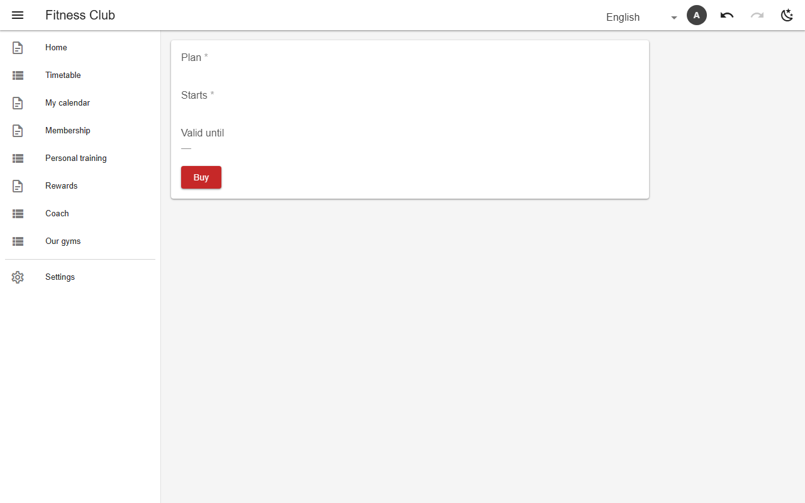

# Undo & redo

Every cell edit, add, delete and archive is recorded where it was made. The ↶ ↷ buttons in the app bar step back and forward; replays go through the normal write path, so access rules and feeds apply as to any other write. The stack is per tab and in memory only.

*Undo enabled in the app bar after an edit*

- No schema needed.

## Backends

| In this browser | Supabase | Firebase | Dev server |
|---|---|---|---|
| ✅ | ✅ | ✅ | ✅ |

[← All features](../README.md)
