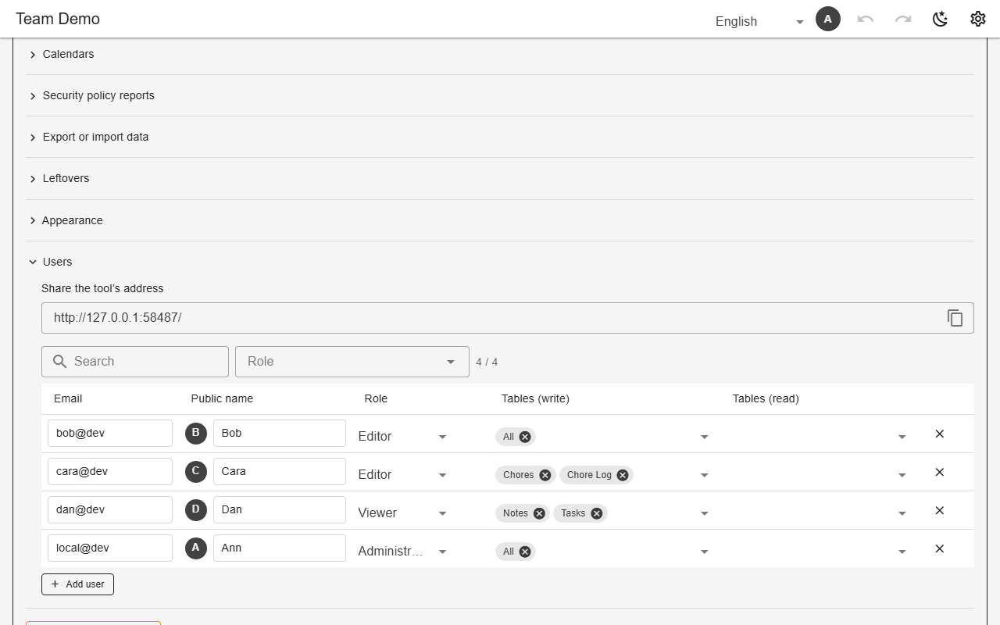

# Users, roles & table grants

The first account to sign in becomes admin. Admins add users and give each a role and per-table grants: **Tables (write)** or **Tables (read)**, or All. Views appear only when the user can read all their sources. The same rules are enforced by the backend itself (Firestore rules, Postgres RLS), not only by the UI.



*Settings → Users (demo)*

## Schema

A grant record:

```json
{"other@gmail.com": {"role": "editor", "tables": {"tasks": "rw", "price_list": "r"}}}
```

- `?user=<email>` on the dev server acts as another user to rehearse their view.

## Backends

| In this browser | Supabase | Firebase | Dev server |
|---|---|---|---|
| ✅ identity is self-asserted (rehearsal) | ✅ | ✅ | ✅ not enforced with `--sqlite` |

## Reference

- [SCHEMA.md → access modes](../../SCHEMA.md#access-modes-r-rw)
- [README → User Registry](../../README.md#user-registry)

[← All features](../README.md)
